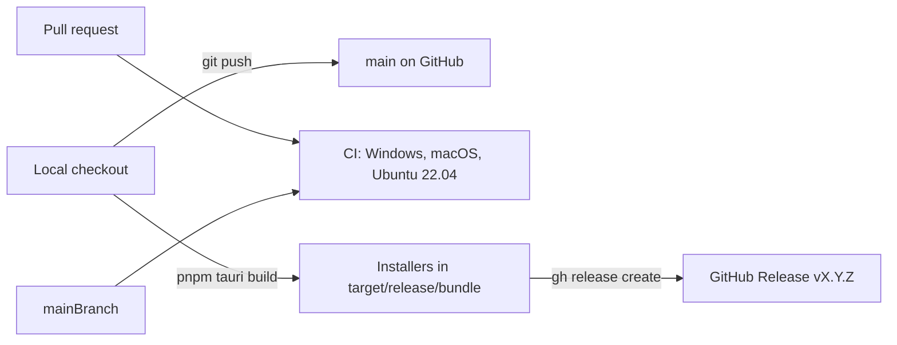
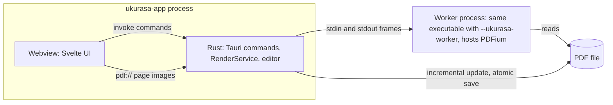

# Infrastructure

How Ukurasa is built, checked, released, and run on a user's machine. [plan.md](plan.md) covers the product, the crate architecture, and the roadmap; this document covers the machinery around the code.



## Repository layout

```
.github/workflows/ci.yml    CI workflow
app/
  frontend/                 Svelte 5 + TypeScript UI, built by Vite
  scripts/fetch-pdfium.mjs  PDFium download, run by pnpm install
  src-tauri/                ukurasa-app crate: window, Tauri commands, pdf:// scheme
    capabilities/           webview permissions
    icons/                  app icons for every platform
    pdfium/                 downloaded PDFium library (gitignored)
    tauri.conf.json         shared Tauri config
    tauri.<os>.conf.json    per-OS overrides, merged over tauri.conf.json
  package.json              frontend scripts and the Tauri CLI
crates/                     Rust libraries and the ukurasa CLI (see plan.md)
docs/                       plan and this document
Cargo.toml                  workspace members, shared version, dev-profile overrides
rust-toolchain.toml         Rust channel and components
.gitattributes              line endings
```

All Rust crates, including `app/src-tauri`, build into one `target/` folder at the repository root.

## Toolchain

| Tool | Where the version comes from |
|---|---|
| Rust | `rust-toolchain.toml`: the stable channel with rustfmt and clippy. rustup installs it on the first `cargo` command. |
| Rust dependencies | `Cargo.lock`. CI passes `--locked`, so a stale lock file fails the build. |
| Node.js | 22 in CI; 22 or later locally. |
| pnpm | The `packageManager` field in `app/package.json` (pnpm 10.11.0). CI reads it. |
| Frontend dependencies | `app/pnpm-lock.yaml`. CI passes `--frozen-lockfile`. |
| Tauri CLI | The `@tauri-apps/cli` dev dependency, run as `pnpm tauri`. |

The stable channel moves every six weeks, and a new Rust release can add clippy lints that fail CI. Fix the new warnings, or pin a release such as `channel = "1.95.0"` in `rust-toolchain.toml`.

## Runtime



### Processes

- The app executable has two modes. It normally starts Tauri; with `--ukurasa-worker` as its first argument, it runs `ukurasa_worker::run` and hosts PDFium instead. One executable keeps the installers simple and guarantees the worker matches the app version.
- PDFium parses untrusted files and is not thread-safe, so it never runs in the app process. When the worker crashes or breaks the protocol, `ukurasa-render` restarts it once and reopens the current document at its current revision.
- The worker protocol (`crates/ukurasa-render/src/protocol.rs`) sends frames over stdin and stdout: a little-endian `u32` header length, a JSON header, a little-endian `u32` payload length, and the raw payload. Headers are capped at 16 MiB and payloads at 512 MiB.
- `RenderService` runs one renderer thread with a priority queue (lower values render first), cancels requests for pages that scrolled away, and keeps rendered pages in a 128 MiB PNG cache.
- Page images reach the webview through the `pdf` custom URI scheme, never through JSON. The frontend builds the URL with `convertFileSrc` (`pdf://localhost/...` on macOS and Linux, `http://pdf.localhost/...` on Windows), encoding the document, page, width, priority, and request ID. `viewer::serve_page` answers it.
- Tauri commands live in `viewer.rs` (open, recent files, links, render cancellation), `editor.rs` (text lines, fonts, edit previews, save), and `chrome.rs` (Windows title bar).

### Locating PDFium

`load_pdfium` in `crates/ukurasa-worker/src/lib.rs` tries, in order:

1. `UKURASA_PDFIUM_PATH`, a file or a folder. Unless it is already set, the app sets it for the worker to the `pdfium` folder in the bundle's resource directory.
2. The folder of the running executable.
3. The system library search path.

### Saving

- **Save** (`ukurasa_core::save`) refuses a read-only file or one whose size or modification time changed since it was opened. It applies the edits through `ukurasa-edit` as an incremental update, so the original bytes stay intact.
- Both **Save** and **Save as** write atomically: the new bytes go to `.<name>.<pid>.tmp` beside the target, are flushed and read back to verify them, take the original file's permissions, and are renamed over the target. A failed save leaves the target untouched.

### Security boundaries

- The content security policy in `tauri.conf.json` allows only the app's own files, Tauri IPC, and the `pdf` scheme, plus `data:` and `blob:` images. The app loads no remote content.
- `capabilities/default.json` grants the core defaults plus window close, minimize, drag, and maximize for the custom title bar. The webview has no filesystem or shell access: file dialogs, file reads, saves, and opening links all run in Rust commands.
- Release builds on Windows use the GUI subsystem, so no console window appears.

### Window chrome per platform

- **Windows**: `tauri.windows.conf.json` turns off native decorations, and the Svelte title bar draws the window buttons. `chrome.rs` layers a native child window over the maximize button so Snap Layouts work. `build.rs` embeds `windows-app-manifest.xml`, which declares Windows 10 support; layered child windows need it.
- **macOS**: `tauri.macos.conf.json` uses the overlay title bar with a hidden title, so the traffic lights sit over the app's own title bar.
- **Linux**: native decorations.

### App data

| Data | Location |
|---|---|
| Recent files | `recent.json` in the app data folder: `%APPDATA%\app.ukurasa.Ukurasa` on Windows, `~/Library/Application Support/app.ukurasa.Ukurasa` on macOS, `~/.local/share/app.ukurasa.Ukurasa` on Linux |
| Sidebar state and saved signatures | Webview local storage (`ukurasa.sidebar`, `ukurasa.sidebarTab`, `ukurasa.signatures`), kept by the platform webview; on Windows in `%LOCALAPPDATA%\app.ukurasa.Ukurasa\EBWebView` |

Uninstalling leaves this data in place; delete the folders to reset the app. Keep the identifier `app.ukurasa.Ukurasa` fixed after the first release, because a new identifier starts with empty recent files and signatures.

## PDFium

- Ukurasa uses prebuilt PDFium from [bblanchon/pdfium-binaries](https://github.com/bblanchon/pdfium-binaries). `app/scripts/fetch-pdfium.mjs` pins the release (`chromium/8125`), which must match the PDFium API targeted by the `pdfium_latest` feature of `pdfium-render`.
- `pnpm install` runs the script as `postinstall`. It picks the archive for Node's platform and architecture (Windows, macOS, and Linux, each x64 or arm64), checks its SHA-256 against the pinned value, extracts the library and its license files into `app/src-tauri/pdfium/`, and writes a `RELEASE.txt` stamp. It skips the download when the stamp already matches.
- `pnpm pdfium` downloads again. `UKURASA_SKIP_PDFIUM=1` skips the download, and `UKURASA_PDFIUM_PATH` points the app at a local build.
- `bundle.resources` in `tauri.conf.json` copies `pdfium/`, licenses included, into every package.
- The worker's integration test renders real pages, so CI runs `pnpm install` before `cargo test`.

To update PDFium:

1. Pick a release from bblanchon/pdfium-binaries and set `RELEASE` in `fetch-pdfium.mjs`.
2. Replace the six SHA-256 values with the hashes of the new archives.
3. Check that `pdfium-render` supports that PDFium version, and update the crate if needed.
4. Run `pnpm pdfium` and `cargo test --workspace`.

## Builds

| Build | Command | Result |
|---|---|---|
| Development app | `pnpm tauri dev` in `app/` | Vite dev server on `localhost:1420` with hot reload, and the Rust code in the dev profile |
| Release app | `pnpm tauri build` in `app/` | `target/release/ukurasa-app` plus installers in `target/release/bundle/` |
| Rust workspace | `cargo build --workspace` | Libraries, the app, and the CLI in the dev profile |
| CLI | `cargo build --release -p ukurasa-cli` | `target/release/ukurasa` |

- The dev profile compiles `ukurasa-worker`, `pdfium-render`, and the PNG and compression crates at `opt-level = 3` (see the root `Cargo.toml`). Unoptimized rendering runs about 45 times slower.
- `pnpm tauri build` runs `pnpm build` (Vite writes `app/frontend/dist`), then `cargo build --release`, then the Tauri bundler.
- `bundle.targets` is `all`: NSIS and MSI on Windows, `.app` and DMG on macOS, and deb, rpm, and AppImage on Linux. Pass `--bundles` to build fewer.
- Packages match the build machine. An x64 Windows machine produces x64 installers, and an Apple silicon Mac produces an `aarch64` DMG. PDFium follows Node's architecture, so build natively for each target.
- Linux packages require at least the glibc version of the machine that built them. Build on Ubuntu 22.04 to support glibc 2.35 and later.

## Continuous integration

`.github/workflows/ci.yml` runs on every push to `main` and on every pull request. A newer push to the same branch or pull request cancels the run in progress.

Each job runs on `windows-latest`, `macos-latest` (Apple silicon), and `ubuntu-22.04`, and one failing platform does not cancel the others. The steps are:

1. Check out the code.
2. On Linux, install WebKitGTK and the other Tauri system packages.
3. Install the Rust toolchain from `rust-toolchain.toml`.
4. Restore the Cargo cache ([Swatinem/rust-cache](https://github.com/Swatinem/rust-cache)), keyed by `Cargo.lock` and the toolchain.
5. Set up pnpm and Node 22, with the pnpm store cached.
6. `pnpm install --frozen-lockfile`, which also fetches PDFium.
7. `pnpm check`: svelte-check for TypeScript and Svelte errors.
8. `pnpm build`: the production frontend build.
9. `cargo fmt --all --check`.
10. `cargo clippy --workspace --all-targets --locked -- -D warnings`.
11. `cargo test --workspace --locked`.

CI does not build installers, sign anything, or publish releases.

### Duration and cost

The first run took about 15 minutes on Windows, 6 on Ubuntu, and 2 on macOS; later runs reuse the Cargo cache. Public repositories run on standard runners for free. Private repositories pay for minutes beyond the plan's included usage, and a macOS minute costs about 10 times a Linux minute, a Windows minute about twice. Watch usage under **Settings > Billing and plans** on GitHub. To spend less, skip macOS on pull requests or add `paths-ignore` for documentation changes.

### Required checks

To block merges into `main` until CI passes, add a branch ruleset under **Settings > Rules** that requires the `windows-latest`, `macos-latest`, and `ubuntu-22.04` checks. Private repositories need GitHub Pro or a paid organization plan for rulesets.

## Releases

Releases are manual for now. Each one is a Git tag `v<version>` with the installers attached.

1. **Bump the version.** Edit `version` under `[workspace.package]` in the root `Cargo.toml`, and keep `app/package.json` in step. Tauri reads the app version from Cargo, because `tauri.conf.json` sets none. The next build updates `Cargo.lock`; commit both files.
2. **Merge to `main`** and wait for CI to pass.
3. **Build on Windows** from an up-to-date `main`:

   ```powershell
   cd app
   pnpm install --frozen-lockfile
   pnpm tauri build
   cd ..
   ```

4. **Create the release.** `gh release create` creates the tag on `main` if it does not exist, and `--generate-notes` lists the changes since the previous tag.

   ```powershell
   $v = "0.2.0"
   gh release create "v$v" `
     "target\release\bundle\nsis\Ukurasa_${v}_x64-setup.exe" `
     "target\release\bundle\msi\Ukurasa_${v}_x64_en-US.msi" `
     --target main --title "Ukurasa $v" --generate-notes
   ```

5. **Add macOS and Linux packages** when you can build them. On the Mac or Linux machine, check out the tag, build, and upload:

   ```sh
   git fetch --tags && git checkout v0.2.0
   cd app && pnpm install --frozen-lockfile && pnpm tauri build && cd ..
   gh release upload v0.2.0 target/release/bundle/dmg/*.dmg
   gh release upload v0.2.0 target/release/bundle/deb/*.deb target/release/bundle/rpm/*.rpm target/release/bundle/appimage/*.AppImage
   ```

Use `gh auth status` to confirm that `gh` uses the account that owns the repository. Pass `--clobber` to `gh release upload` to replace an asset. Version numbers stay at `0.x` while the project is in early development.

## Code signing

The installers are unsigned. Windows shows a SmartScreen warning, and macOS Gatekeeper blocks the first launch; the README lists the workarounds. Linux packages need no signature to install.

To sign later:

- **Windows**: [SignPath Foundation](https://signpath.org) signs open source projects for free and requires a public repository. [Azure Trusted Signing](https://learn.microsoft.com/azure/trusted-signing/) is a paid monthly service. Tauri calls either through `bundle.windows.signCommand`.
- **macOS**: an Apple Developer Program membership (USD 99 per year) provides a Developer ID certificate and notarization. Tauri signs and notarizes the app when the `APPLE_*` signing variables are set.

## Possible automation

- A release workflow using [tauri-apps/tauri-action](https://github.com/tauri-apps/tauri-action) on every `v*` tag, building all platforms and uploading to a draft release. Runner minutes make this the largest Actions cost on a private repository, mostly for macOS.
- Automatic updates with `tauri-plugin-updater`, which checks a signed `latest.json` manifest published with each release. Downloads from a private repository need a token, so this fits best once the repository is public.
- More architectures: Windows arm64, Intel macOS, and Linux arm64 through extra matrix entries on GitHub's arm64 and Intel runners.
- Distribution channels from the plan: winget, a Homebrew cask, and Flathub.

## Line endings

`.gitattributes` stores text files with LF line endings and checks them out with LF on every platform (`* text=auto eol=lf`). It overrides Git for Windows' `core.autocrlf=true` default, which caused "LF will be replaced by CRLF" warnings. PDFs, images, fonts, and icons are marked binary so Git never converts them. After changing `.gitattributes`, run `git add --renormalize .` to apply the rules to tracked files.
